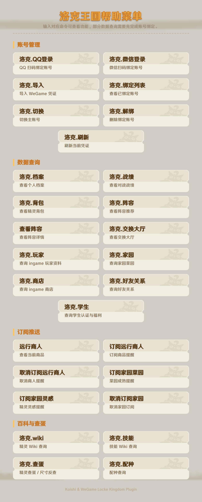
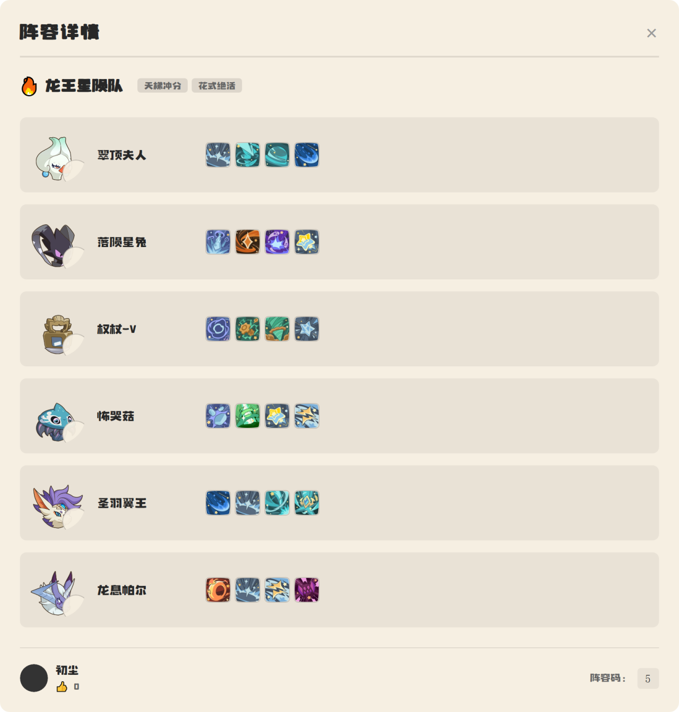
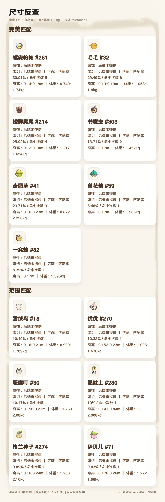
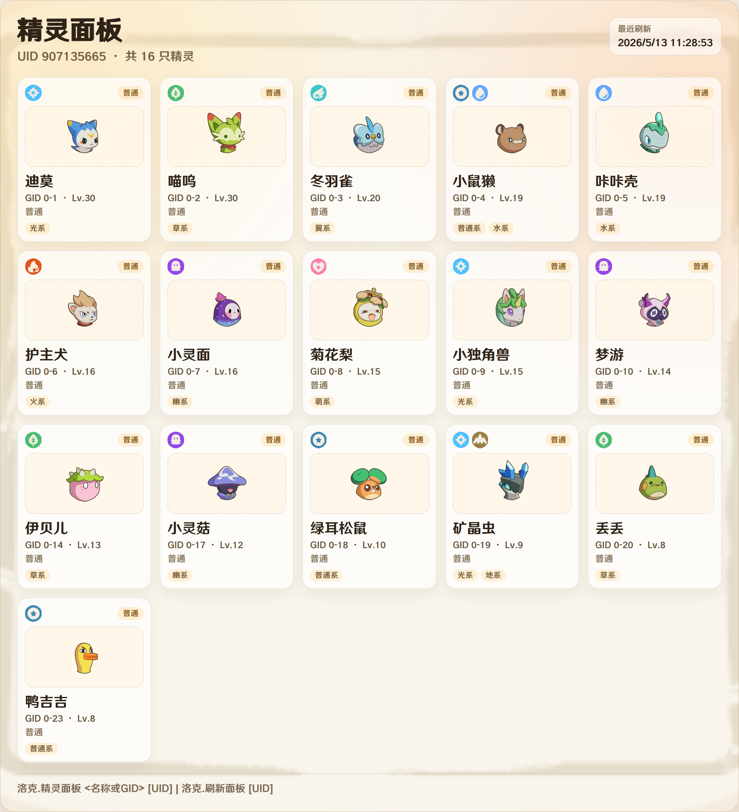

<div align="center">

# koishi-plugin-rocom


**交流反馈群：1097809141**  

---

APIkey获取请访问：[洛克魔法书](https://rocom.shallow.ink/)
---

</div>
  
[](https://www.npmjs.com/package/koishi-plugin-rocom)

Koishi 版洛克王国数据查询插件。插件基于 WeGame / 后端接口提供账号绑定、个人档案、战绩、背包、阵容、交换大厅、远行商人、查蛋配种、Wiki 查询等功能。

### 安全免责声明

- 绑定后的 `token`、`ticket`、扫码凭证等均属于敏感信息，请务必自行妥善保存。
- 请勿截图公开、发送他人，或提交到公开仓库，避免凭证泄露后被冒用。
- 因凭证或绑定信息泄露导致的账号风险、查询被冒用或相关损失，需要由使用者自行承担。
- 非必要不要频繁手动刷新凭证，服务端会自动刷新。

## 使用前准备

本插件依赖 Koishi 的 `database` 服务和 `koishi-plugin-puppeteer` 服务。请先在 Koishi 控制台启用：

- `database`
- `puppeteer`
- `rocom`

如果图片渲染失败，插件会尽量回落为文字结果；但档案、战绩、背包、阵容、交换大厅、远行商人、活动日历和查蛋配种等功能推荐配合 Puppeteer 使用。

| 功能     | 示例图片                                           | 功能     | 示例图片                                           |
| -------- | -------------------------------------------------- | -------- | -------------------------------------------------- |
| 帮助菜单 |      | 个人档案 |  |
| 背包     |  | 阵容推荐 |  |
| 阵容详情 |  | 远行商人 |  |
| 家园     |  | 查蛋     |  |
| 精灵面板 |  |

## 配置项

| 配置项                               | 默认值                               | 说明                                                    |
| ------------------------------------ | ------------------------------------ | ------------------------------------------------------- |
| `apiBaseUrl`                         | `https://wegame.shallow.ink`         | 后端 API 基础地址                                       |
| `wegameApiKey`                       | 空                                   | WeGame API Key，如后端要求鉴权则填写                    |
| `qqLoginDebugMode`                   | `false`                              | QQ 扫码登录调试模式，可能输出敏感凭证，仅调试时开启     |
| `adminUserIds`                       | `[]`                                 | Bot 管理员用户 ID 列表，用于管理员命令                  |
| `autoRefreshEnabled`                 | `false`                              | 是否启用自动刷新凭证                                    |
| `autoRefreshTime`                    | `["00:00", "12:00"]`                 | 自动刷新凭证的时间点                                    |
| `merchantSubscriptionEnabled`        | `true`                               | 是否启用远行商人订阅检查                                |
| `merchantSubscriptionItems`          | `["国王球", "棱镜球", "炫彩精灵蛋"]` | 默认关注的远行商人商品                                  |
| `merchantAllDayOnceEnabled`          | `false`                              | 开启后订阅推送中全天在售商品每天只推送一次，4 小时轮次商品仍每轮推送 |
| `merchantCheckInterval`              | `300000`                             | 远行商人订阅检查间隔，单位毫秒                          |
| `merchantPrivateSubscriptionEnabled` | `true`                               | 是否允许私聊订阅远行商人推送                            |
| `homeSubscriptionEnabled`            | `true`                               | 是否启用家园菜园和灵感订阅推送                          |
| `homeSubscriptionIntervalMinutes`    | `5`                                  | 家园订阅检查间隔，单位分钟                              |
| `imageCompressionEnabled`            | `true`                               | 是否对 PNG 图片启用无损压缩                             |
| `imageCompressionMinBytes`           | `262144`                             | 触发压缩的最小图片大小，单位字节                        |
| `imageCompressionLevel`              | `9`                                  | PNG zlib 压缩等级，范围 `0-9`，数值越大通常越小但更耗时 |

### 图片压缩设置

后台配置页中有单独的“图片压缩设置”分组。Puppeteer 渲染图默认以 JPEG 发送，用于降低图片体积；仍以 PNG 进入发送链路的图片会按该设置对 IDAT 数据做无损重压缩，不会改变图片尺寸、画质或透明度。若压缩失败，或压缩后文件没有变小，会自动发送原图。

## 快速开始

1. 启用 `database`、`puppeteer` 和本插件。
2. 使用 `洛克.QQ登录` 或 `洛克.微信登录` 绑定账号。
3. 发送 `洛克.档案` 测试账号数据是否可正常查询。
4. 发送 `洛克` 查看内置帮助菜单。

```text
洛克.QQ登录
洛克.档案
洛克.背包
洛克.查蛋 喵喵
洛克.刷新面板
洛克.精灵面板 火神
```

## 指令说明

完整的指令列表、参数与示例请到指令文档查看：

- [指令说明文档](docs/commands.md)

## 常见问题

### 提示“您尚未绑定洛克王国账号”

请先使用 `洛克.QQ登录` 或 `洛克.微信登录` 绑定账号，再使用档案、战绩、背包、阵容、交换大厅等账号相关功能。

### 图片生成失败

请检查：

- 是否启用了 `koishi-plugin-puppeteer`。
- Puppeteer 是否能正常启动浏览器。
- 服务器是否能访问模板中引用的远程图片。
- 平台是否允许发送图片消息。

插件在图片失败时会尽量发送文字回退结果。

### QQ 扫码登录超时

二维码有效期约 2 分钟。超时后请重新发送 `洛克.QQ登录`。

### 远行商人订阅没有推送

请检查：

- `merchantSubscriptionEnabled` 是否开启。
- 会话是否已经使用 `订阅远行商人` 设置订阅，可用 `查看远行商人订阅` 确认当前订阅内容。
- 按关键词订阅时，商品名称是否能命中当前远行商人商品（按包含关系匹配）。
- 全部订阅模式（`订阅远行商人 全部`）在本轮商品为空时不会推送；每轮 `08:00 / 12:00 / 16:00 / 20:00` 只推一次，已推过的轮次不会重复。
- Bot 是否有向目标群聊发送消息的权限。

## 许可证

本项目使用 AGPL-3.0 License。


## WeGame rocom 模块对齐更新

对齐上游 WeGame-GameModules rocom 分支（v0.2.1）的以下能力（换蛋广场暂未移植）：

> 双插件逐功能渲染对比图见 [docs/feature-comparison/](docs/feature-comparison/)（左侧 Yunzai · WeGame rocom，右侧本插件；含功能矩阵总图，可用 `node docs/feature-comparison/render.js` 与 `node docs/feature-comparison/matrix.js` 重新生成）。

### Yunzai UI 移植（v1.0.22）

- **阵容分享码 · 信笺风**（`share-code-classic` 模板）：立绘背景框、火漆印、属性/血脉图标与专属字体整套移植；性格加减益由 Wiki 性格摘要自动解析（兼容「+攻击 -特攻」「攻击↑ 防御↓」「加速度 减魔攻」等写法）。配置 `shareCodeUiStyle`：`classic`（默认，信笺风）/ `panel`（原面板版）。
- **家园详情 · classic**（`pet-detail-classic` 模板）：立绘 + 六维属性表（数值/个体/成长）+ 装备/已学技能分栏 + 血脉/属性标签；classic 模式跳过不需要的体重范围 Wiki 查询，低带宽模式同样跳过技能图标。配置 `homeDetailUiStyle`：`classic`（默认）/ `panel`（原面板版）。

> 全量回归说明：本次随移植新增了命令级回归测试 `npm run test:commands`（注册全部命令模块、逐条调用、接口 null/畸形数据对抗、订阅调度与去重、生命周期 dispose），并修复测试中发现的两个问题：`洛克.档案`/`洛克.战绩` 在角色名字段缺失时回退文本显示 `undefined`（现在兜底为「洛克玩家」）；`订阅远行商人` 不带参数重复订阅时回显「沿用上次配置」但实际重置为配置默认商品（现在真正沿用上次配置，含全部模式）。

### 远行商人订阅体验

- 新增 `商人商品` 命令：查看远行商人商品目录（`merchant/info?random_goods=all`）与订阅序号，目录内存缓存 6 小时并落盘兜底。
- `订阅远行商人` 支持按序号订阅（`订阅远行商人 1 3 5`，解析后立刻换成商品名落盘，后端调整目录顺序不影响已有订阅）、扩展「全部」写法（全物品/所有/all/* 等），回显与 `查看远行商人订阅` 均带「序号.名称」。
- `@全体` 写法：`订阅远行商人 @全体 1 3`；重新订阅未指定 1/0 或 @全体 时沿用上次的 @全体 设置。
- 当天实时价格记录：实时接口只返回当前轮次价格、旧接口 `random_goods[].price` 恒为 0，现在每次查询/订阅轮询都会把实时价格按 `goods_id + 轮次` 记入 `rocom_merchant_price_log.json`（按上海自然日分桶，跨天自动清空），「今日远行商人」的历史轮次商品自动补价。

### 家园订阅与查询

- 家园生蛋订阅改用轻量 `ingame/home/eggs` 接口轮询（失败自动回退全量家园信息），显著降低轮询开销；菜园/灵感订阅不变。
- 新增 `洛克.家园状态 [UID]`：立即查询指定 UID 的家园蛋状态（可收蛋精灵与生蛋倒计时，文字结果）。
- 新增 `我的家园订阅`：查看当前群/自己的家园订阅列表，含上次检查与推送时间。
- 三类家园订阅（`订阅家园菜园/灵感/生蛋`）支持 `@全体` 写法（如 `订阅家园生蛋 @全体 12345`），群订阅命中后尝试 @全体；未指定时沿用上次设置。

### 家园精灵一览

- 新增 `洛克.家园精灵 [UID]`（走 `ingame/home/pet-data` 接口）：一张图列出全家园精灵的等级、性别、体重、声音（分贝与声线标注）、变异标记（异色/炫彩/异色炫彩）和生蛋倒计时，可收蛋的精灵排在最前并带「可收蛋」角标。

## RoCom 4.2 对齐更新

对齐上游 astrbot 插件 v4.2.0 / v4.2.1 的远行商人改动：

- 新增 `merchantAllDayOnceEnabled` 开关（默认关闭）：开启后订阅推送中全天在售商品每天只推送一次，4 小时刷新的轮次商品仍每轮推送。全天/轮次商品按接口 `next_refresh_time`、`disable_time`、`round` 等真实字段判定，不依赖商品名去重，连续轮次售卖相同商品不受影响；“订阅远行商人 全部”（每轮推送整张商人图）不受该开关影响。已推送的全天商品按订阅、按天记录在 `allday_pushed`，跨天自动失效。
- 修复实时商人接口不返回商品图片地址时商品图 404：缺图标时按 `goods_mapping` 的 `item_id` / `item_kind` 使用 Wiki 公共物品图（`/api/v1/resources/wiki/assets/items/{kind}/{id}.png`），仍缺失时使用本地 logo 兜底；洛克商店渲染同样受益。
- 修复商人接口连续失败时的空推送：订阅检查在接口失败时记录错误并按空结果链路等待稍后重试（最多 3 次），不再渲染空商品图片。

上游 v4.3.0 的字体异步下载修复针对 AstrBot 事件循环阻塞，Koishi 侧渲染本就是异步执行，无需对齐。

## RoCom 4.1 对齐更新

新增异色/炫彩排行榜、阵容分享码解析与历史查询；玩家查询显示新版名片和收集数，远行商人优先使用实时接口。查蛋优先接入 Egg API，并在图文中标注体型。公告支持图片和长文分页。

订阅已统一权限、Bot 定向发送、失败重试和卸载取消。原有白名单继续生效；默认同时允许群主/管理员管理当前群订阅。要维持只允许 Bot 管理员的策略，将 `subscriptionGroupAdminEnabled` 设为 false。

| 新配置 | 默认值 | 作用 |
| --- | --- | --- |
| `subscriptionGroupAdminEnabled` | true | 群主/管理员管理商人、家园及公告订阅 |
| `subscriptionBotAdminEnabled` | true | 白名单或高权限用户管理订阅 |
| `subscriptionBotAdminAuthority` | 4 | Koishi Bot 管理员权限阈值 |
| `merchantTimezone` | Asia/Shanghai | 商人轮次、显示时间和调度时区 |
| `renderTimeout` | 30000 | 导航、图片、字体和截图共享的总预算（毫秒） |

现有 `merchantUiStyle` 选择新/旧商人界面，`merchantCheckMode` 选择间隔或指定时刻，`merchantCheckTimes` 设置 HH:MM 列表。

开发检查：`npm run check`、`npm run build`、`npm run test:alignment`。真实浏览器检查在构建后执行 `npm run test:render`，可通过 `ROCOM_TEST_BROWSER` 指定本地 Chrome 路径；测试拦截 HTTP(S) 请求。

详细结果见 [修复验收记录](docs/rocom-4.1-fixes-2026-09-21.md)。生产后端权限与官方 QQ 的实际投递仍需在部署环境联调。
